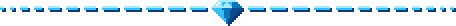
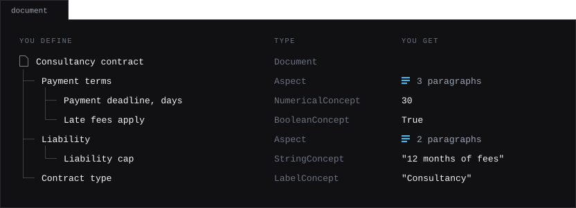
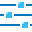

<!-- markdownlint-disable MD033 -->
<p align="center">
  <a href="https://contextgem.shcherbak.ai"></a>
</p>

<h1 align="center">Extract structured data and insights from documents<br>using LLMs and decision models</h1>

<p align="center">
  Describe, don't prompt.
</p>

<p align="center">
  <a href="https://pypi.org/project/contextgem/"></a>
  <a href="https://pypi.org/project/contextgem/"></a>
  <a href="https://pypi.org/project/contextgem/"></a><br>
  <a href="https://github.com/shcherbak-ai/contextgem/actions/workflows/ci-tests.yml"></a>
  <a href="https://github.com/shcherbak-ai/contextgem/actions/workflows/ci-tests.yml"></a>
  <a href="https://www.bestpractices.dev/projects/10489"></a>
</p>

<p align="center">
  <a href="https://www.producthunt.com/products/contextgem?embed=true&utm_source=badge-featured&utm_medium=badge&utm_campaign=badge-contextgem-1-0"></a>
</p>

<p align="center">
  <a href="https://contextgem.shcherbak.ai/quickstart/"><strong>Quickstart</strong></a> ·
  <a href="https://contextgem.shcherbak.ai/how_it_works/"><strong>How it works</strong></a> ·
  <a href="https://contextgem.shcherbak.ai/agentic_workflows/"><strong>Agentic&nbsp;workflows</strong></a> ·
  <a href="CHANGELOG.md"><strong>Changelog</strong></a> ·
  <a href="SECURITY.md"><strong>Security</strong></a> ·
  <a href="https://contextgem.shcherbak.ai/"><strong>Documentation</strong></a>
</p>

<p align="center">
  <br>
  <sup>An illustrative contract. Every extracted fact is traced back to its source.</sup>
</p>
<!-- markdownlint-enable MD033 -->

> [!NOTE]
> **New in 1.0: decision models.** Next to LLMs, ContextGem now works with decision models, which answer closed questions (yes/no, one of your labels, a level of a scale) with the probability of each possible answer, fast and at a low cost. A model group sends each aspect and concept to the model that suits it, and any model can fall back on others: see [LLMs and decision models](#llms-and-decision-models).
>
> **Upgrading from 0.x?** Some classes and parameters are renamed or removed, some defaults have changed, and Python 3.10 is no longer supported. Follow the [migration guide](https://contextgem.shcherbak.ai/migration_v1/), or point a coding agent at [llms.txt](https://contextgem.shcherbak.ai/llms.txt), the index of the documentation.

ContextGem is a free, open-source framework that does the work around the models for you: the prompts, the data models, the source references and the justifications, with minimal code.

<!-- markdownlint-disable MD033 -->
<p align="center"></p>
<!-- markdownlint-enable MD033 -->

## Why ContextGem

Reliable extraction from documents usually means writing prompts, designing validation models, mapping outputs back to the source, orchestrating multi-step pipelines and tracking usage across models. ContextGem has all of this built in, in one declarative pipeline that you can reuse and serialize.

<!-- markdownlint-disable MD033 -->
<table>
<tr>
<td width="33%" valign="top"><div align="center"><br><strong>No prompts to write</strong></div><br>Prompts are generated from your descriptions of what to extract.</td>
<td width="33%" valign="top"><div align="center"><br><strong>Typed, validated output</strong></div><br>Text, numbers, dates, booleans, labels, ratings and JSON objects.</td>
<td width="34%" valign="top"><div align="center"><br><strong>Every fact traced to its source</strong></div><br>Items map back to their paragraphs or sentences, with the reasoning on request.</td>
</tr>
<tr>
<td valign="top"><div align="center"><br><strong>Nested context</strong></div><br>Aspects, sub-aspects and concepts focus the model on the text that matters.</td>
<td valign="top"><div align="center"><br><strong>The right model for each question</strong></div><br>An LLM where it takes reasoning, a decision model where a fast, low-cost answer is enough.</td>
<td valign="top"><div align="center"><br><strong>Answers with probabilities</strong></div><br>A decision model gives the probability of each possible answer, and you set the threshold.</td>
</tr>
</table>
<!-- markdownlint-enable MD033 -->

Read more on the [motivation](https://contextgem.shcherbak.ai/motivation/) behind ContextGem.

## LLMs and decision models

ContextGem works with two kinds of models. You describe what to extract in the same way for both, and each aspect and concept goes to the model that suits it.

<!-- markdownlint-disable MD033 -->
<p align="center">
  <br>
  <sup>An illustrative service agreement: the open question goes to the LLM, the closed ones to the decision model.</sup>
</p>
<!-- markdownlint-enable MD033 -->

<!-- markdownlint-disable MD033 -->
| | <br>LLM | <br>Decision model |
|---|---|---|
| **How it answers** | Writes the answer, which ContextGem validates into typed items | Gives the probability of each possible answer, and writes no text |
| **What it extracts** | Aspects and every type of concept, from text and images | Aspects, and Boolean, label and rating concepts, from text |
| **With each item** | References to paragraphs or sentences, and a justification on request | The probabilities of all the possible answers, and a decision threshold that you set for the model, or for each aspect and concept |
| **Use it for** | Open values, and answers that take reasoning | Closed questions in volume, where a fast, low-cost answer is enough |
| **Models** | Any cloud or local LLM through [LiteLLM](https://github.com/BerriAI/litellm): OpenAI, Anthropic, Google, Azure OpenAI, xAI, Ollama, LM Studio and more | TypeSafe Jev, OpenAI Decisions API, Microsoft Foundry and more, cloud or local |
| **Read more** | [Supported LLMs](https://contextgem.shcherbak.ai/llms/supported_llms/), [configuration](https://contextgem.shcherbak.ai/llms/llm_config/), [extraction methods](https://contextgem.shcherbak.ai/llms/llm_extraction_methods/) | [Decision models](https://contextgem.shcherbak.ai/decision_models/decision_models/) |
<!-- markdownlint-enable MD033 -->

> **Choosing a model.** ContextGem is tested with hosted LLMs such as `gpt-6-luna` (OpenAI) and `claude-haiku-5-5` (Anthropic), and with decision models such as Jev (TypeSafe). A smaller LLM, such as many that run locally, may not follow the detailed extraction instructions: check it on a sample of your documents, and see the [troubleshooting guide](https://contextgem.shcherbak.ai/optimizations/optimization_small_llm_troubleshooting/) if it falls short. Before you give questions to a decision model, compare it with an LLM on a sample of your documents: see [when to use a decision model](https://contextgem.shcherbak.ai/decision_models/decision_models/#when-to-use-a-decision-model).

<!-- markdownlint-disable MD033 -->
<p align="center"></p>
<!-- markdownlint-enable MD033 -->

## Quick start

```bash
uv add contextgem             # or: pip install -U contextgem
uv add "contextgem[docling]"  # with Docling, to convert PDF, DOCX and other files
```

### Extract with an LLM

An LLM extracts aspects and values of any type. Below, it extracts two things from a contract: an aspect, the **payment terms**, which comes back as the paragraphs on payments, and a concept, the **anomalies**, which span the whole document and which retrieval-based approaches can miss. Each anomaly comes with a justification and the sentence it was found in.

```python
import os

from contextgem import Aspect, Document, DocumentLLM, StringConcept


doc = Document(
    raw_text=(
        "Consultancy Agreement\n"
        "This agreement between Company A (Supplier) and Company B (Customer)...\n"
        "The term of the agreement is 1 year from the Effective Date...\n"
        "The Supplier shall provide consultancy services as described in Annex 2...\n"
        "The Customer shall pay the Supplier within 30 calendar days of receiving an invoice...\n"
        "The purple elephant danced gracefully on the moon while eating ice cream.\n"  # 💎 anomaly
        "Time-traveling dinosaurs will review all deliverables before acceptance.\n"  # 💎 another anomaly
        "This agreement is governed by the laws of Norway...\n"
    ),
)

doc.add_aspects(
    [
        Aspect(
            name="Payment terms",
            description="Clauses on payments, fees and invoices",
        )
    ]
)
doc.add_concepts(
    [
        StringConcept(
            name="Anomalies",
            description="Anomalies in the document",
            add_references=True,
            reference_depth="sentences",
            add_justifications=True,
            justification_depth="brief",
        )
    ]
)

llm = DocumentLLM(
    model="openai/gpt-6-luna",  # or another LLM, cloud or local
    api_key=os.environ.get("CONTEXTGEM_OPENAI_API_KEY"),
)
doc = llm.extract_all(doc)

payment_terms = doc.get_aspect_by_name("Payment terms").extracted_items
# 1 item, the paragraph: "The Customer shall pay the Supplier within 30 calendar
#     days of receiving an invoice..."

anomalies = doc.get_concept_by_name("Anomalies").extracted_items
# 2 items. The first one:
# .value: "The statement that a purple elephant danced on the moon while eating
#     ice cream is anomalous and unrelated to the consultancy agreement."
# .justification: "It is an implausible, fantastical statement in an otherwise
#     contractual document."
# .reference_sentences: the sentence of the purple elephant

```

<!-- markdownlint-disable MD033 -->
<p align="center">
  <br>
  <sup>What the example above extracts: an aspect gives back the document's own text, a concept gives new values with their sources.</sup>
</p>
<!-- markdownlint-enable MD033 -->

### Extract with a decision model

A decision model answers closed questions (yes/no, one of your labels, a level of a scale) with the probability of each possible answer. Below, it extracts an aspect from a contract, the **termination** clauses, by deciding for each paragraph whether it is one, and answers two questions about the contract, concepts, in one request.

```python
import os

from contextgem import (
    Aspect,
    BooleanConcept,
    Document,
    DocumentDecisionModel,
    LabelConcept,
)


doc = Document(
    raw_text=(
        "Service Agreement\n"
        "Either party may terminate this Agreement for any reason by giving 30 days' "
        "written notice to the other party.\n"
        "This Agreement is governed by the laws of the State of New York.\n"
    ),
)

doc.add_aspects(
    [
        Aspect(
            name="Termination",
            description="Clauses on termination of the agreement",
        )
    ]
)
doc.add_concepts(
    [
        BooleanConcept(
            name="Termination for convenience",
            description="Either party may terminate the agreement without cause",
        ),
        LabelConcept(
            name="Notice form",
            description="Required form of the termination notice",
            labels=["Written", "Email", "Any form", "Not specified"],
            classification_type="multi_class",
        ),
    ]
)

decision_model = DocumentDecisionModel(
    model="typesafe/jev-latest",  # or another decision model, cloud or local
    api_key=os.environ.get("CONTEXTGEM_TYPESAFE_API_KEY"),
)
# The aspect: a yes/no question for each paragraph. The concepts: both in one request.
doc = decision_model.extract_all(doc)

termination_clauses = doc.get_aspect_by_name("Termination").extracted_items
# 1 item, the paragraph: "Either party may terminate this Agreement for any reason..."
# .probabilities: {True: 0.99, False: 0.01} (rounded); the other two paragraphs
#     had 0.26 and 0.03, below the decision threshold of 0.5

convenience = doc.get_concept_by_name("Termination for convenience").extracted_items[0]
# .value: True
# .probabilities: {True: 0.98, False: 0.02} (rounded)

notice_form = doc.get_concept_by_name("Notice form").extracted_items[0]
# .value: ["Written"]
# .probabilities: {"Written": 1.0, "Email": 0.0, "Any form": 0.0, "Not specified": 0.0}

```

<!-- markdownlint-disable MD033 -->
<p align="center">
  <br>
  <sup>What the example above extracts: a yes or no for each paragraph, and an answer for each concept, each with its probability.</sup>
</p>
<!-- markdownlint-enable MD033 -->

### Start from a file with Docling

Your documents are files. [Docling](https://github.com/docling-project/docling) converts them, and [`Document.from_docling()`](https://contextgem.shcherbak.ai/documents/docling/) makes a document of the result, in which each paragraph keeps its place in the structure of the file, e.g. the column headers of its table row, and the pages it is on. ContextGem supports files in these formats:

<!-- markdownlint-disable MD033 -->
<table align="center">
<tr>
<td align="center" valign="top"><br><sub>PDF</sub></td>
<td align="center" valign="top"><br><sub>DOCX, DOC, RTF,<br>ODT, Pages</sub></td>
<td align="center" valign="top"><br><sub>PPTX, PPT,<br>ODP, Keynote</sub></td>
<td align="center" valign="top"><br><sub>XLSX, XLS,<br>ODS, Numbers</sub></td>
<td align="center" valign="top"><br><sub>CSV</sub></td>
<td align="center" valign="top"><br><sub>EPUB</sub></td>
<td align="center" valign="top"><br><sub>Email</sub></td>
<td align="center" valign="top"><br><sub>Box Notes</sub></td>
</tr>
<tr>
<td align="center" valign="top"><br><sub>Images</sub></td>
<td align="center" valign="top"><br><sub>Audio</sub></td>
<td align="center" valign="top"><br><sub>Video</sub></td>
<td align="center" valign="top"><br><sub>WebVTT</sub></td>
<td align="center" valign="top"><br><sub>HTML, MHTML</sub></td>
<td align="center" valign="top"><br><sub>Markdown</sub></td>
<td align="center" valign="top"><br><sub>AsciiDoc</sub></td>
<td align="center" valign="top"><br><sub>LaTeX</sub></td>
</tr>
<tr>
<td align="center" valign="top"><br><sub>XBRL</sub></td>
<td align="center" valign="top"><br><sub>JATS XML</sub></td>
<td align="center" valign="top"><br><sub>USPTO XML</sub></td>
<td align="center" valign="top"><br><sub>DocLang</sub></td>
<td align="center" valign="top"><br><sub>Docling JSON</sub></td>
<td align="center" valign="top"><br><sub>METS GBS</sub></td>
<td align="center" valign="top"><br><sub>EBCDIC</sub></td>
<td align="center" valign="top"><br><sub>AFP</sub></td>
</tr>
</table>
<!-- markdownlint-enable MD033 -->

Each format is tested with files of its own. The [supported formats](https://contextgem.shcherbak.ai/documents/docling/#supported-formats) give the extensions, and what some formats need, e.g. LibreOffice for DOC, PPT, XLS and RTF.

Below, an LLM extracts an aspect and a concept from a [two-page service agreement](tests/other_files/docling/service_agreement.pdf), and each item is cited by its page.

```python
import os

from docling.document_converter import DocumentConverter

from contextgem import Aspect, Document, DocumentLLM, JsonObjectConcept


# Convert the file with Docling, e.g. PDF, DOCX, PPTX, XLSX or HTML
result = DocumentConverter().convert("service_agreement.pdf")
# The paragraphs keep their place in the structure of the file and their pages
doc = Document.from_docling(result.document)

doc.add_aspects(
    [
        Aspect(
            name="Termination",
            description="Clauses on the term of the agreement and its termination",
        )
    ]
)
doc.add_concepts(
    [
        JsonObjectConcept(
            name="Fees",
            description="The monthly fee of each service",
            structure={"service": str, "monthly_fee_eur": float, "billing": str},
            add_references=True,
        )
    ]
)

llm = DocumentLLM(
    model="openai/gpt-6-luna",  # or another LLM, cloud or local
    api_key=os.environ.get("CONTEXTGEM_OPENAI_API_KEY"),
)
doc = llm.extract_all(doc)

termination = doc.get_aspect_by_name("Termination")
# .extracted_items: 3 items, the heading of section 3 and clauses 3.1 and 3.2
# .reference_page_numbers: [2]

fees = doc.get_concept_by_name("Fees").extracted_items
# 3 items, one for each row of the table of fees. The first one:
# .value: {"service": "Hosting", "monthly_fee_eur": 1200.0,
#     "billing": "In advance"}
# .reference_paragraphs: the table row, with the header of each column:
#     "Service: Hosting; Monthly fee: 1,200 EUR; Billing: In advance"
# .reference_page_numbers: [1]

```

<!-- markdownlint-disable MD033 -->
<p align="center">
  <br>
  <sup>What the example above extracts: each fee from its row of the table, and the termination clauses, each cited by its page.</sup>
</p>
<!-- markdownlint-enable MD033 -->

### More examples

<!-- markdownlint-disable MD033 -->
<table>
<tr>
<th align="left" valign="middle" width="29%">&nbsp;&nbsp;&nbsp; Documents</th>
<td valign="middle"><a href="https://contextgem.shcherbak.ai/quickstart/#concept-extraction-from-document-vision">Images</a>&nbsp;· <a href="https://contextgem.shcherbak.ai/documents/docling/#what-the-document-is-made-of">Files&nbsp;from&nbsp;Docling</a>&nbsp;· <a href="https://contextgem.shcherbak.ai/documents/document_config/#providing-additional-context-for-paragraphs">Paragraph&nbsp;context</a>&nbsp;· <a href="https://contextgem.shcherbak.ai/serialization/#example-usage">Saving&nbsp;and&nbsp;loading</a></td>
</tr>
<tr>
<th align="left" valign="middle" width="29%">&nbsp;&nbsp;&nbsp; Aspects and concepts</th>
<td valign="middle"><a href="https://contextgem.shcherbak.ai/quickstart/#aspect-extraction-from-document">Aspects</a>&nbsp;· <a href="https://contextgem.shcherbak.ai/quickstart/#extracting-aspect-with-sub-aspects">Sub-aspects</a>&nbsp;· <a href="https://contextgem.shcherbak.ai/quickstart/#concept-extraction-from-document-text">Concepts&nbsp;of&nbsp;a&nbsp;document</a>&nbsp;· <a href="https://contextgem.shcherbak.ai/quickstart/#concept-extraction-from-aspect">Concepts&nbsp;of&nbsp;an&nbsp;aspect</a>&nbsp;· <a href="https://contextgem.shcherbak.ai/advanced_usage/#extracting-aspects-containing-concepts">Aspects&nbsp;with&nbsp;concepts</a>&nbsp;· <a href="https://contextgem.shcherbak.ai/concepts/json_object_concept/#defining-structure">JSON&nbsp;objects</a>&nbsp;· <a href="https://contextgem.shcherbak.ai/concepts/label_concept/#multi-class-vs-multi-label-classification">Classification</a>&nbsp;· <a href="https://contextgem.shcherbak.ai/concepts/string_concept/#references-and-justifications-for-extraction">References</a>&nbsp;· <a href="https://contextgem.shcherbak.ai/aspects/aspects/#justifications-for-extraction">Justifications</a>&nbsp;· <a href="https://contextgem.shcherbak.ai/pipelines/extraction_pipelines/#simple-pipeline-creation">Reusable&nbsp;pipelines</a></td>
</tr>
<tr>
<th align="left" valign="middle" width="29%">&nbsp;&nbsp;&nbsp; LLMs</th>
<td valign="middle"><a href="https://contextgem.shcherbak.ai/llms/supported_llms/#cloud-based-llms">Cloud&nbsp;models</a>&nbsp;· <a href="https://contextgem.shcherbak.ai/llms/supported_llms/#local-llms">Local&nbsp;models</a>&nbsp;· <a href="https://contextgem.shcherbak.ai/llms/llm_extraction_methods/">Extraction&nbsp;methods</a>&nbsp;· <a href="https://contextgem.shcherbak.ai/llms/llm_config/#setting-the-reasoning-effort">Reasoning&nbsp;effort</a>&nbsp;· <a href="https://contextgem.shcherbak.ai/llms/llm_config/#configuring-fallback-llms">Fallbacks</a>&nbsp;· <a href="https://contextgem.shcherbak.ai/llms/llm_config/#accessing-usage-and-cost-statistics">Usage&nbsp;and&nbsp;cost</a>&nbsp;· <a href="https://contextgem.shcherbak.ai/quickstart/#lightweight-llm-chat-interface">Chat</a>&nbsp;· <a href="https://contextgem.shcherbak.ai/quickstart/#chat-with-tools">Chat&nbsp;with&nbsp;tools</a></td>
</tr>
<tr>
<th align="left" valign="middle" width="29%">&nbsp;&nbsp;&nbsp; Decision models</th>
<td valign="middle"><a href="https://contextgem.shcherbak.ai/decision_models/decision_models/#supported-providers-and-models">Cloud&nbsp;models</a>&nbsp;· <a href="https://contextgem.shcherbak.ai/decision_models/decision_models/#local-decision-models">Local&nbsp;models</a>&nbsp;· <a href="https://contextgem.shcherbak.ai/decision_models/decision_models/#quick-start">Concepts</a>&nbsp;· <a href="https://contextgem.shcherbak.ai/decision_models/decision_models/#extracting-aspects">Aspects</a>&nbsp;· <a href="https://contextgem.shcherbak.ai/decision_models/decision_models/#decision-threshold">Decision&nbsp;threshold</a>&nbsp;· <a href="https://contextgem.shcherbak.ai/decision_models/decision_models/#fallback-chains">Fallbacks</a>&nbsp;· <a href="https://contextgem.shcherbak.ai/decision_models/decision_models/#usage-and-cost">Usage&nbsp;and&nbsp;cost</a></td>
</tr>
<tr>
<th align="left" valign="middle" width="29%">&nbsp;&nbsp;&nbsp; Model groups</th>
<td valign="middle"><a href="https://contextgem.shcherbak.ai/llms/llm_config/#model-groups">LLMs&nbsp;with&nbsp;roles</a>&nbsp;· <a href="https://contextgem.shcherbak.ai/decision_models/decision_models/#using-a-decision-model-in-a-model-group">LLM&nbsp;and&nbsp;decision&nbsp;model</a>&nbsp;· <a href="https://contextgem.shcherbak.ai/advanced_usage/#using-a-multi-llm-pipeline-to-extract-data-from-several-documents">Several&nbsp;documents</a></td>
</tr>
<tr>
<th align="left" valign="middle" width="29%">&nbsp;&nbsp;&nbsp; Agentic workflows</th>
<td valign="middle"><a href="https://contextgem.shcherbak.ai/agentic_workflows/#at-ingestion-metadata-for-every-document">Metadata&nbsp;at&nbsp;ingestion</a>&nbsp;· <a href="https://contextgem.shcherbak.ai/agentic_workflows/#in-a-tool-extraction-on-demand">Extraction&nbsp;in&nbsp;a&nbsp;tool</a>&nbsp;· <a href="https://contextgem.shcherbak.ai/agentic_workflows/#serving-the-tool-over-mcp">A&nbsp;tool&nbsp;over&nbsp;MCP</a>&nbsp;· <a href="https://contextgem.shcherbak.ai/agentic_workflows/#at-a-decision-point-choosing-the-next-step">A&nbsp;decision&nbsp;point</a>&nbsp;· <a href="https://contextgem.shcherbak.ai/agentic_workflows/#choosing-the-tools-of-an-agent">Choosing&nbsp;the&nbsp;tools</a></td>
</tr>
</table>
<!-- markdownlint-enable MD033 -->

<!-- markdownlint-disable MD033 -->
<p align="center"></p>
<!-- markdownlint-enable MD033 -->

## How it works

<!-- markdownlint-disable MD033 -->
<p align="center">
  <br>
  <sup>An illustrative contract: what you define, and what is extracted.</sup>
</p>
<!-- markdownlint-enable MD033 -->

1. **Wrap your content in a [Document](https://contextgem.shcherbak.ai/documents/document_config/).** Pass text, images or both, or **start from a file** that [Docling](https://github.com/docling-project/docling) converts: [`Document.from_docling()`](https://contextgem.shcherbak.ai/documents/docling/) keeps its structure and the page of each paragraph.
2. **Say what to extract.** [Aspects](https://contextgem.shcherbak.ai/aspects/aspects/) pull out the parts of the document on a topic, as paragraphs or sentences. [Concepts](https://contextgem.shcherbak.ai/concepts/supported_concepts/) extract typed values from the whole document or from an aspect, with optional references and justifications. Keep a set of both as a reusable [extraction pipeline](https://contextgem.shcherbak.ai/pipelines/extraction_pipelines/).
3. **Run a model.** One call to an [LLM](https://contextgem.shcherbak.ai/llms/llm_extraction_methods/), a [decision model](https://contextgem.shcherbak.ai/decision_models/decision_models/) or a [model group](https://contextgem.shcherbak.ai/llms/llm_config/#model-groups) of both extracts everything. A group sends each aspect and concept to the model of its role, e.g. the closed questions to a decision model and the rest to an LLM, and each model can have fallbacks.

Read more on [how ContextGem works](https://contextgem.shcherbak.ai/how_it_works/) in the documentation.

## In agentic workflows

An agent plans and works across documents and steps. ContextGem reads one document in depth and returns typed values with their sources, or the probabilities of the answers to closed questions. The two meet at three points:

<!-- markdownlint-disable MD033 -->
<p align="center">
  <br>
  <sup>Where ContextGem runs in an agentic workflow.</sup>
</p>
<!-- markdownlint-enable MD033 -->

- **At ingestion**: convert each new file with [Docling](https://contextgem.shcherbak.ai/documents/docling/) and extract its metadata once, so that agents find documents by their type, parties or dates.
- **In a tool**: an agent calls an extraction and gets the values with the sentences they came from, without the document in its context. The tool is a Python function, for ContextGem's own chat, an agent framework or an MCP server.
- **At a decision point**: a decision model answers a closed question with the probability of each answer, so that the workflow branches on a value that you defined and knows how sure the model is of it. Before the turn of an agent with many tools, it can also pick the groups of tools that the request needs.

See [Agentic workflows](https://contextgem.shcherbak.ai/agentic_workflows/) in the documentation for an example of each.

## Every paragraph is read

ContextGem is built for in-depth analysis of individual documents. There is no search step that picks the chunks that look relevant, as in RAG: the model reads every paragraph of the text it extracts from, all at once or in [batches of paragraphs](https://contextgem.shcherbak.ai/optimizations/optimization_long_docs/) of a size you set, so no fact is missed because a search ranked its passage low. This avoids the retrieval inconsistencies that make RAG [struggle with complex concepts and nuanced insights](https://www.linkedin.com/pulse/raging-contracts-pitfalls-rag-contract-review-shcherbak-ai-ptg3f).

The trade-off: ContextGem does not query across documents or search a corpus. For these, RAG frameworks (e.g. LlamaIndex, Haystack) remain more appropriate.

## How it is tested

Besides tests that replay recorded responses of real models, [Hypothesis](https://hypothesis.readthedocs.io/) property tests run whole extractions on generated model outputs, including what a model should never return: IDs that are not in the prompt, values of the wrong type or not valid JSON, and responses cut off at the max output tokens. They check that such an output is rejected and retried, or reported with an error or a warning, and that it never yields extracted items. A change that can affect the quality of the extraction is measured on evaluation cases, i.e. complex documents with reference answers, against a recorded baseline of quality and cost. What exact matching cannot compare (narrative values, justifications and text fields) is judged by a decision model, Jev: it answers one yes/no question at a time with a probability, and is checked on answers whose verdict is known before it is used. See [Testing](CONTRIBUTING.md#-testing).

## Documentation

Full documentation: **[contextgem.shcherbak.ai](https://contextgem.shcherbak.ai)**

<!-- markdownlint-disable MD033 -->
<table>
<tr>
<th align="center" valign="top"><br>Get started</th>
<th align="center" valign="top"><br>Define what to extract</th>
<th align="center" valign="top"><br>Run models</th>
<th align="center" valign="top"><br>Optimize</th>
</tr>
<tr>
<td valign="top"><a href="https://contextgem.shcherbak.ai/installation/">Installation</a><br><a href="https://contextgem.shcherbak.ai/quickstart/">Quickstart</a><br><a href="https://contextgem.shcherbak.ai/advanced_usage/">Advanced usage</a><br><a href="https://contextgem.shcherbak.ai/how_it_works/">How it works</a><br><a href="https://contextgem.shcherbak.ai/migration_v1/">Migrating to v1.0</a></td>
<td valign="top"><a href="https://contextgem.shcherbak.ai/documents/document_config/">Documents</a><br><a href="https://contextgem.shcherbak.ai/documents/docling/">Files converted with Docling</a><br><a href="https://contextgem.shcherbak.ai/aspects/aspects/">Aspects</a><br><a href="https://contextgem.shcherbak.ai/concepts/supported_concepts/">Concepts</a><br><a href="https://contextgem.shcherbak.ai/pipelines/extraction_pipelines/">Extraction pipelines</a><br><a href="https://contextgem.shcherbak.ai/serialization/">Serialization</a></td>
<td valign="top"><a href="https://contextgem.shcherbak.ai/llms/supported_llms/">Supported LLMs</a><br><a href="https://contextgem.shcherbak.ai/llms/llm_config/">LLM configuration</a><br><a href="https://contextgem.shcherbak.ai/llms/llm_extraction_methods/">Extraction methods</a><br><a href="https://contextgem.shcherbak.ai/decision_models/decision_models/">Decision models</a><br><a href="https://contextgem.shcherbak.ai/llms/chat_with_tools/">Chat with tools</a><br><a href="https://contextgem.shcherbak.ai/agentic_workflows/">Agentic workflows</a></td>
<td valign="top"><a href="https://contextgem.shcherbak.ai/optimizations/optimization_accuracy/">Accuracy</a><br><a href="https://contextgem.shcherbak.ai/optimizations/optimization_speed/">Speed</a><br><a href="https://contextgem.shcherbak.ai/optimizations/optimization_cost/">Cost</a><br><a href="https://contextgem.shcherbak.ai/optimizations/optimization_long_docs/">Long documents</a><br><a href="https://contextgem.shcherbak.ai/optimizations/optimization_choosing_llm/">Choosing the right LLM(s)</a></td>
</tr>
</table>
<!-- markdownlint-enable MD033 -->

For LLMs and coding agents, [llms.txt](https://contextgem.shcherbak.ai/llms.txt) indexes the documentation, with a Markdown copy of each page.

For visual architecture maps and natural language Q&A on the codebase, see [DeepWiki](https://deepwiki.com/shcherbak-ai/contextgem).

## Community

<!-- markdownlint-disable MD033 -->
<table>
<tr>
<td width="50%" valign="top"><strong>Need help or want to discuss?</strong><br>Start a thread in <a href="https://github.com/shcherbak-ai/contextgem/discussions/new/">GitHub Discussions</a>.</td>
<td width="50%" valign="top"><strong>Found a bug or have a feature request?</strong><br><a href="https://github.com/shcherbak-ai/contextgem/issues/new">Open an issue</a>.</td>
</tr>
<tr>
<td valign="top"><strong>Want to contribute?</strong><br>Contributions are welcome, from a fixed typo to a new feature: see the <a href="CONTRIBUTING.md">Contributor Guidelines</a>.</td>
<td valign="top"><strong>Security</strong><br>The code is scanned with <a href="https://codeql.github.com/">CodeQL</a> and <a href="https://github.com/PyCQA/bandit">Bandit</a>, and the dependencies are checked against known advisories: see the <a href="SECURITY.md">security policy</a>.</td>
</tr>
</table>
<!-- markdownlint-enable MD033 -->

## Acknowledgements

ContextGem relies on these excellent open-source packages: [aiolimiter](https://github.com/mjpieters/aiolimiter), [colorlog](https://github.com/borntyping/python-colorlog), [docstring-parser](https://github.com/rr-/docstring_parser), [fastjsonschema](https://github.com/horejsek/python-fastjsonschema), [genai-prices](https://github.com/pydantic/genai-prices), [Jinja2](https://github.com/pallets/jinja), [litellm](https://github.com/BerriAI/litellm), [pillow](https://github.com/python-pillow/Pillow), [pydantic](https://github.com/pydantic/pydantic), [python-ulid](https://github.com/mdomke/python-ulid), [tenacity](https://github.com/jd/tenacity) and [wtpsplit-lite](https://github.com/superlinear-ai/wtpsplit-lite), and, for converting files, [Docling](https://github.com/docling-project/docling).

## License

Apache 2.0 License - see the [LICENSE](LICENSE) and [NOTICE](NOTICE) files for details.

© 2025 [Shcherbak AI AS](https://shcherbak.ai) — Enterprise AI Engineering. We build AI agents to fit your enterprise — each verified, constrained, and governed.

<!-- markdownlint-disable MD033 -->
<p align="center"></p>
<!-- markdownlint-enable MD033 -->

## More from shcherbak_ai

<!-- markdownlint-disable MD033 -->
<table>
  <tr>
    <td width="36%" align="center"><a href="https://github.com/shcherbak-ai/licenseal"></a></td>
    <td>License compatibility checks for dependency trees, fast enough for CI.</td>
  </tr>
  <tr>
    <td width="36%" align="center"><a href="https://github.com/shcherbak-ai/tethered"></a></td>
    <td>Runtime network egress control for Python.</td>
  </tr>
  <tr>
    <td width="36%" align="center"><a href="https://github.com/shcherbak-ai/omerta"></a></td>
    <td>Catches .env secrets leaking into git: your own values, not lookalikes.</td>
  </tr>
</table>
<!-- markdownlint-enable MD033 -->

Questions or collaboration ideas? Reach out on [LinkedIn](https://www.linkedin.com/in/sergii-shcherbak-10068866/) or [X](https://x.com/seshch). Built with ❤️ in Oslo, Norway.
