:og:description: ContextGem: Agentic Workflows

.. meta::
   :description: How to use ContextGem in agentic workflows: extracting the metadata of documents at ingestion, extracting on demand in a tool that an agent calls, and deciding the next step of a workflow, or the tools of an agent, with a decision model.

Agentic Workflows
==================

An agent plans, calls tools and works across documents and steps. ContextGem reads one document in depth and returns typed values, each with the text that it came from, or with the probability of each answer to a closed question. The two meet at three points of a workflow.

.. figure:: _static/contextgem_agentic_workflows.svg
   :width: 100%
   :alt: A map of an agentic workflow with the three places where ContextGem runs: at ingestion, where a new document goes to ContextGem, which extracts its metadata into a search index or database, where the agent finds documents by their metadata; in a tool, which the agent calls and which returns values with their sources; and at a decision point, where a clear answer is acted on and an unclear one goes to a person.
   :align: center
   :class: dark-light

.. list-table::
   :header-rows: 1
   :widths: 22 39 39

   * - Where
     - What ContextGem does
     - What the agent gets
   * - :ref:`At ingestion <agentic-ingestion-label>`
     - Extracts the metadata of each new document once, with a pipeline
     - Records to filter and route on, without reading the documents again
   * - :ref:`In a tool <agentic-tool-label>`
     - Extracts what the agent asks for, when it asks
     - Values with the sentences they came from, without the document in its context
   * - :ref:`At a decision point <agentic-decision-label>`
     - Answers closed questions with a decision model
     - A branch to take, or the tools for its turn, and how sure the model is of the answer

The examples below work on the same service agreement, and show the answers that the models gave.

.. _agentic-ingestion-label:

📥 At Ingestion: Metadata for Every Document
----------------------------------------------

When a document enters your system, e.g. a knowledge base that agents search, extract its metadata once and store it with the document. An agent then finds documents by their type, parties or dates, and does not have to read a document to learn what it is.

". The values make up the record of the document.
   :align: center
   :class: dark-light

.. literalinclude:: ../../dev/usage_examples/docs/agentic_workflows/ingestion_metadata.py
   :language: python

**Key points:**

* **Define the fields once**, as an :class:`~contextgem.public.pipelines.ExtractionPipeline`. ``assign_pipeline()`` gives each document a copy of its aspects and concepts, so one pipeline serves all the documents. The pipeline is serialized with ``to_json()``, e.g. to keep the definition of the metadata next to the records made with it (see :doc:`pipelines/extraction_pipelines`)
* **Send each field to the model that suits it.** In a :class:`~contextgem.public.models.DocumentModelGroup`, a decision model answers the closed questions (a type, a yes/no flag) fast and at a low cost per document, and an LLM extracts the open values. Store the probabilities with the values, so that a search can leave out the uncertain ones, or a person can check them (see :doc:`decision_models/decision_models`)
* **Keep the processed document.** ``document.to_json()`` holds every extracted item with its references and justifications, and ``Document.from_json()`` restores it later, e.g. in a tool that returns the sources of a value, without extracting again (see :doc:`serialization`)
* **Index aspects as labelled passages.** An aspect extracts the paragraphs on a topic, e.g. the termination clauses. Indexed as passages labelled with the name of the aspect, they let a search look in the termination clauses only (see :doc:`aspects/aspects`)
* **Extract many documents concurrently** with ``extract_all_async()``, one call per document, run together with ``asyncio.gather()``. With ``use_concurrency=True``, the requests of all the calls that run in an event loop share the rate set by the ``async_limiter`` of each model (see :doc:`llms/llm_config`)

.. _agentic-tool-label:

🛠️ In a Tool: Extraction on Demand
-------------------------------------

When an agent needs facts from a document, it calls a tool that runs an extraction. The extraction reads the whole document in a request of its own, and the agent gets back the values with the sentences that they came from: the document stays out of the context of the agent, and the agent can quote its sources.

cument and finds the sentence on termination. The tool returns the value with its source sentence, and the agent answers that 30 days' written notice is needed, quoting the sentence.
   :align: center
   :class: dark-light

.. literalinclude:: ../../dev/usage_examples/docs/agentic_workflows/extraction_tool.py
   :language: python

**Key points:**

* **The tool is a Python function** with type hints and a docstring. Here, ContextGem's own chat runs it (see :doc:`llms/chat_with_tools`). Agent frameworks that take a Python function as a tool take this one as it is, e.g. the OpenAI Agents SDK with ``function_tool(extract_from_document)``, or PydanticAI with ``Agent(..., tools=[extract_from_document])``
* **The agent describes what it needs** as the name and the description of a concept, as you would, and ContextGem builds the prompt from them. For the questions that you know in advance, define the concepts yourself, or extract them at ingestion and have the tool return the stored values, without a request
* **Return the values and their sources only.** The result of a tool is added to the context of the agent, and is sent with each of its next requests
* **Use the async methods in async code.** Agent frameworks run tools in an event loop: ``extract_concepts_from_document_async()`` and the other ``_async`` methods run in that loop, while a sync method called in a running event loop runs in a thread of its own and blocks the loop until it is done
* **The extractor can be another model** than the agent's: a smaller LLM, a decision model for closed questions, or a model group. Its usage and cost are tracked apart from the agent's, with ``extractor.get_usage()`` and ``extractor.get_cost()``

Serving the Tool over MCP
~~~~~~~~~~~~~~~~~~~~~~~~~~

To give the tool to any agent that connects to Model Context Protocol (MCP) servers, e.g. a coding agent or a desktop assistant, serve the same function with an MCP server. With version 2 of the `MCP Python SDK <https://github.com/modelcontextprotocol/python-sdk>`_ (``uv add mcp``):

.. code-block:: python

   from mcp.server.mcpserver import MCPServer

   # `extract_from_document` and what it uses: as in the example above
   server = MCPServer("documents")
   server.add_tool(extract_from_document)

   if __name__ == "__main__":
       server.run()  # over stdio, or server.run("streamable-http") over HTTP

In version 1 of the SDK, the server class is ``FastMCP``, imported from ``mcp.server.fastmcp``.

.. _agentic-decision-label:

🔀 At a Decision Point: Choosing the Next Step
------------------------------------------------

Where a workflow branches, e.g. before an agent takes a step that is hard to undo, ask the question as a concept of a decision model. A decision model answers a closed question with the probability of each possible answer and generates no text, so the workflow branches on a value that you defined, and the probability tells how clear the answer is.

ble; in between, human_review.
   :align: center
   :class: dark-light

.. literalinclude:: ../../dev/usage_examples/docs/agentic_workflows/decision_point.py
   :language: python

**Key points:**

* **Act on clear answers, and leave the rest to a person.** Two bounds of your choice set apart the answers that the workflow acts on, and a person decides in between. A probability is the estimate of the model: check the bounds on a sample of your documents before you rely on them (see :ref:`decision-models-trust-label`)
* **Route by a label.** A :class:`~contextgem.public.concepts.LabelConcept` with ``classification_type="multi_class"`` picks one of your labels, e.g. the workflow or the agent that takes a document, with the probability of each label
* **Check the output of an agent.** The same questions check a document that an agent wrote, e.g. that a draft states the notice period, before it is sent. A failed check goes back to the agent as feedback
* **Only a decision model gives probabilities.** An item extracted by an LLM, including an LLM that is a fallback of the decision model, has ``probabilities=None``: send it to a person, or decide on its value
* **Use an LLM where the answer takes reasoning**, dates or arithmetic (see :ref:`decision-models-when-to-use-label`)

.. _agentic-tool-selection-label:

Choosing the Tools of an Agent
~~~~~~~~~~~~~~~~~~~~~~~~~~~~~~~

The descriptions of all the tools of an agent are sent with each of its requests, and among many tools the agent can pick a wrong one. Before the turn of the agent, a decision model can decide which groups of tools the request needs: a :class:`~contextgem.public.concepts.LabelConcept` with ``classification_type="multi_label"`` and the groups as its labels asks one yes/no question for each label, and the agent gets the tools of the groups at or above the decision threshold.

.. literalinclude:: ../../dev/usage_examples/docs/agentic_workflows/tool_selection.py
   :language: python

**Key points:**

* **Name each group by what its tools do.** A label is sent as it is, without a description of its own, so "Look up invoices" says more than ``look_up_invoice``. Put related tools under one label, so that each label has a clear meaning
* **Set the threshold low.** A tool offered in vain costs the tokens of its description, while a tool left out can leave the agent unable to do the task. When no label reaches the threshold, no item is extracted: keep all the tools then, or a default set
* **Decide on what the choice depends on**, e.g. the request together with the last turns of the conversation, as the text of the document. The questions of up to 128 labels go in one request, and more in further requests on the same text (see :ref:`decision-models-limits-label`)
* **The tools can change from one turn of a chat to the next.** A :class:`~contextgem.public.llms.ChatSession` keeps the tool calls of the earlier turns, with their results, when a turn offers other tools or none, so the agent keeps what it found with them (checked with ``gpt-6-luna`` and ``claude-haiku-5-5``). The thinking blocks of the earlier turns are sent back only while the tools stay the same (see :doc:`llms/chat_with_tools`)
* **With fallback LLMs, set the tools of each fallback LLM first**, and then those of the agent: the tools of a fallback LLM must be those of the LLM it falls back from, which is checked when the tools of the agent change (see :ref:`llm-tools-fallback-label`)

⚙️ At Any of These Points
---------------------------

* **Hand results to the next step as JSON.** Documents with their extracted items, pipelines and model configurations are serialized with ``to_json()`` and restored with ``from_json()``, also in another process or service. The credentials of the models (API key and API base) are left out (see :doc:`serialization`)
* **Track the cost of each step.** Each model counts its own usage and cost, so give each step a model of its own and read its ``get_usage()`` and ``get_cost()`` (see :doc:`llms/llm_config`)
* **Plan for failures.** Fallback models take over when a model fails. When none is left, :class:`~contextgem.public.exceptions.ModelAPIError` or :class:`~contextgem.public.exceptions.ModelExtractionError` is raised, both caught by ``except ContextGemError``. With ``raise_exception_on_extraction_error`` set to ``False`` in the extraction method, a warning is logged instead, and the aspects and concepts of the failed call have no items
* **Treat documents as untrusted input.** The text of a document is sent to the models, and can hold instructions aimed at them. Pass extracted values to an agent as data, e.g. as the result of a tool, and take the steps that matter on closed answers, whose values are the ones that you defined
* **Leave the agent's work to the agent framework:** planning, memory, search across documents and the orchestration of steps (see :doc:`how_it_works`)
