.. meta::
   :description: How to create a Document from a file converted with Docling in one of the supported formats, e.g. PDF, DOCX, PPTX, XLSX or HTML, with the structure of the file in the additional context of the paragraphs and the pages of each paragraph.

Converting Files with Docling
==============================

`Docling <https://github.com/docling-project/docling>`_ converts files in many formats into a ``DoclingDocument``. :meth:`~contextgem.public.documents.Document.from_docling` creates a ContextGem document from it, for a file in one of the :ref:`supported formats <docling-formats-label>`, e.g. PDF, DOCX, PPTX, XLSX or HTML, in which each paragraph keeps what plain text loses:

* **its place in the structure of the file**, e.g. the headings of its section, or the column headers of its table row, which the models get together with the paragraph;
* **the pages it is on**, which give the pages of the items that refer to it.

.. figure:: ../_static/contextgem_docling.svg
   :width: 100%
   :alt: A two-page service agreement in PDF, converted with Docling, and what an LLM extracts from it. From the table of fees on page 1, the concept Fees gives three JSON objects, one for each row, e.g. the service Hosting with a monthly fee of 1200.0 EUR billed in advance, each cited on page 1. From section 3 on page 2, the aspect Termination gives back the heading and clauses 3.1 and 3.2, cited on page 2.
   :align: center
   :class: dark-light

📦 Installation
----------------

.. code-block:: bash

   uv add "contextgem[docling]"

Or using pip:

.. code-block:: bash

   pip install -U "contextgem[docling]"

The ``docling`` extra installs Docling and PyTorch, on which Docling runs its models, e.g. those that find the layout and the tables of a PDF file. On Linux, PyTorch comes with the CUDA libraries of NVIDIA by default; for a CPU-only PyTorch, see the `installation guide of Docling <https://docling-project.github.io/docling/installation/>`_. The extra does not install on an Intel Mac (see :doc:`../installation`).

.. tip::
   A Docling document converted elsewhere, e.g. by a Docling Serve instance, or saved by Docling as JSON and loaded with ``DoclingDocument.load_from_json()``, needs only the document model of Docling, not Docling itself: ``uv add contextgem docling-core``.

.. _docling-formats-label:

📄 Supported Formats
---------------------

``from_docling()`` supports the files in these formats. Its tests convert files in each of them with Docling, and check the paragraphs and the images of the document made of each. Some formats need more than the ``docling`` extra:

.. list-table::
   :header-rows: 1
   :widths: 40 25 35

   * - Format
     - Extensions
     - Needs
   * - PDF, also scanned, which Docling reads with OCR
     - ``.pdf``
     -
   * - Images, e.g. scans, which Docling reads with OCR
     - ``.png``, ``.tiff``
     -
   * - Word
     - ``.docx``, ``.doc``
     - LibreOffice, for DOC
   * - PowerPoint
     - ``.pptx``, ``.ppt``
     - LibreOffice, for PPT
   * - Excel
     - ``.xlsx``, ``.xls``
     - LibreOffice, for XLS
   * - Rich Text Format
     - ``.rtf``
     - LibreOffice
   * - OpenDocument text, spreadsheet and presentation
     - ``.odt``, ``.ods``, ``.odp``
     - ``docling-slim[format-opendocument]``
   * - Apple Pages, Numbers and Keynote
     - ``.pages``, ``.numbers``, ``.key``
     -
   * - HTML, and web pages saved in one file (MHTML)
     - ``.html``, ``.mhtml``
     -
   * - Markdown
     - ``.md``
     -
   * - AsciiDoc
     - ``.asciidoc``
     -
   * - LaTeX
     - ``.tex``
     -
   * - CSV
     - ``.csv``
     -
   * - WebVTT subtitles
     - ``.vtt``
     -
   * - EPUB
     - ``.epub``
     -
   * - Email
     - ``.eml``, ``.msg``
     -
   * - Box Notes
     - ``.boxnote``
     -
   * - JATS XML articles
     - ``.nxml``
     -
   * - USPTO XML patents
     - ``.xml``
     -
   * - XBRL reports
     - ``.xbrl``
     - ``docling-slim[format-xml-xbrl]``, and the taxonomy of the report
   * - DocLang, the markup of Docling, as XML and as an archive
     - ``.dclg``, ``.dclx``
     -
   * - Google Books packages (METS GBS)
     - ``.tar.gz``
     -
   * - EBCDIC records of mainframes
     - ``.ebc``
     - The layout of the records
   * - AFP print streams
     - ``.afp``
     -
   * - Audio, which Docling transcribes
     - ``.mp3``
     - ``docling[asr]`` and ffmpeg
   * - Video, whose speech Docling transcribes and whose frames it samples
     - ``.mp4``
     - ``docling[asr]`` and ffmpeg
   * - Docling JSON, which Docling saves its documents in
     - ``.json``
     -

Docling also takes other extensions of these formats, e.g. ``.adoc`` for AsciiDoc, ``.markdown`` for Markdown, ``.jpg`` for images, ``.wav`` for audio and ``.mov`` for video. What the formats in the last column need:

* **LibreOffice**: Docling converts a DOC, XLS, PPT or RTF file into DOCX, XLSX or PPTX with `LibreOffice <https://www.libreoffice.org>`_, and then converts that. It finds LibreOffice on the ``PATH``, or in its folder on macOS. The installer for Windows does not add it to the ``PATH``: add its ``program`` folder, e.g. ``C:\Program Files\LibreOffice\program``, or set ``DOCLING_LIBREOFFICE_CMD`` to its ``soffice.exe``. On Debian or Ubuntu: ``sudo apt-get install libreoffice-writer libreoffice-calc libreoffice-impress``.
* **XBRL**: ``uv add "docling-slim[format-xml-xbrl]"`` installs Arelle, with which Docling reads a report. It reads the report with its taxonomy, from a folder that holds the schema and the linkbases that the report refers to, and only when it is allowed to read local files:

  .. code-block:: python

     from pathlib import Path

     from docling.datamodel.backend_options import XBRLBackendOptions
     from docling.datamodel.base_models import InputFormat
     from docling.document_converter import DocumentConverter, XBRLFormatOption

     converter = DocumentConverter(
         format_options={
             InputFormat.XML_XBRL: XBRLFormatOption(
                 backend_options=XBRLBackendOptions(
                     taxonomy=Path("taxonomy"), enable_local_fetch=True
                 )
             )
         }
     )

  The facts of a report are key-value pairs, e.g. ``TotalFees: value: 5850; period: 2026-07-01 - 2026-09-30; currency: EUR; decimals: 0``, and its text blocks are text and tables.
* **EBCDIC**: Docling decodes the records with their layout, the ``layout_file`` of ``EbcdicBackendOptions``, which it takes as the ``backend_options`` of ``EbcdicFormatOption``. The records are the rows of a table.
* **Audio and video**: Docling transcribes the speech with Whisper, which ``uv add "docling[asr]"`` installs, and needs `ffmpeg <https://ffmpeg.org>`_ on the ``PATH``. It uses the tiny model of Whisper by default, and a larger one hears better, e.g. ``asr_model_specs.WHISPER_SMALL`` as the ``asr_options`` of ``AsrPipelineOptions`` for audio, or of ``VideoPipelineOptions`` for video.

🚀 From a File to Cited Facts
------------------------------

Convert the file with Docling, create the document with ``from_docling()``, and extract from it as from any other document. Below, an LLM extracts a concept and an aspect from a `two-page service agreement <https://github.com/shcherbak-ai/contextgem/blob/main/tests/other_files/docling/service_agreement.pdf>`_:

.. literalinclude:: ../../../dev/usage_examples/readme/quickstart_docling.py
   :language: python
   :caption: Extracting from a PDF file converted with Docling

Each fee comes from a row of the table, which the LLM gets with the header of each column, and the termination clauses from section 3. ``reference_page_numbers`` gives the pages that an aspect or an extracted item was found on (see :ref:`docling-pages-label`).

🧱 What the Document Is Made Of
--------------------------------

Each piece of text in the body of the file becomes a paragraph, in reading order. Its additional context says what the paragraph is, and where it is in the file:

he context "Section: 2. Fees and Payment". The table caption "Table 1: Monthly fees" is a paragraph of its own. The table becomes a paragraph with its column headers, "Service; Monthly fee; Billing", then a paragraph for each row, with each value after the header of its column, e.g. "Service: Hosting; Monthly fee: 1,200 EUR; Billing: In advance", with the context "Table row", the caption of the table and the section. The page footer is left out. Each paragraph is on page 1.
   :align: center
   :class: dark-light

.. list-table::
   :header-rows: 1
   :widths: 22 48 30

   * - In the file
     - Paragraph
     - Additional context
   * - Title, heading
     - The text
     - ``Title``, ``Heading, level 2``
   * - Body text
     - The text
     - Only the context below, e.g. its section
   * - List item
     - The text, after the number of a numbered item, e.g. ``1. Invoices are payable within 30 days.``, or after its position in its list where the file gives no number, e.g. in HTML
     - ``List item``, ``List item, level 2``
   * - Table
     - A paragraph with the headers of the columns, if the table has them, then a paragraph for each row, with each value after the header of its column, e.g. ``Service: Hosting; Monthly fee: 1,200 EUR``. A cell with paragraphs, a list or checkboxes in it, e.g. in DOCX, HTML or OpenDocument, gives their text, a numbered item after its number and a checkbox with its state, e.g. ``Options: Tea (checked) Coffee (unchecked)``. A table or a picture in a cell is converted after the table, and the cell gives its caption
     - ``Table header``, ``Table row``, with the caption of the table
   * - Caption, footnote, code, formula, checkbox
     - The text
     - e.g. ``Table caption``, ``Picture caption``, ``Footnote``, ``Code``, ``Checkbox, checked``
   * - Form field, key-value pair
     - The key and the value, e.g. ``Full name: Ada Lovelace`` or ``I agree to the terms: checked``
     - ``Form field``, ``Key-value pair``
   * - Cue of a subtitle file, segment of the transcript of an audio or a video file
     - The text, with its start and end times in its custom data (``source``, see :ref:`docling-pages-label`)
     - Only the context below, e.g. the speaker of a cue

Where the file has them, the additional context also gives:

* **the headings of the section** of the paragraph, e.g. ``Section: 3. Term and Termination > 3.2 Notice``;
* **the sheet or the slide**, in a spreadsheet or a presentation, e.g. ``Sheet: Q3 figures`` or ``Slide 2``;
* **the speaker** of a cue, in a subtitle file, e.g. WebVTT: ``Speaker: Ann Berg``;
* **the title**, in a file with several titles, as the top level of the section, e.g. ``List item; Slide 2; Section: Results`` for a list item on a slide titled Results. Each slide of a presentation can have a title, and Docling makes a title of the heading of each chapter of an EPUB file and of each top-level heading (``#``) of a Markdown file. A file with one title has it in no section, as it would be in the context of every paragraph.

**Left out:** page headers and footers, comments, the speaker notes of a presentation, hidden slides and sheets, and the text that Docling finds inside pictures.

**Sentences.** A paragraph that is not running text, i.e. a title or a heading, a table header or row, a form field or a key-value pair, code, a formula, a checkbox or an entry of a list of references, is one sentence from the start: its whole text. A SaT model, which is made for running text, would split e.g. a table row within the text of a cell. The other paragraphs are split into sentences by a SaT model when sentences are needed, e.g. for an aspect with ``reference_depth="sentences"``, as in any document (see :ref:`sat-models-offline`). A reference sentence of a table row is thus the whole row, with its pages.

.. literalinclude:: ../../../dev/usage_examples/docs/documents/docling_conversion.py
   :language: python
   :caption: The paragraphs of a document created from a file converted with Docling

The additional context is sent to the models together with the paragraph, in the requests that list paragraphs: to an LLM, for aspects and for concepts with references (``add_references=True``), and to a decision model, which reads each paragraph on its own, for aspects (see :ref:`paragraph-additional-context`). A concept without references, which is how a decision model extracts concepts, is extracted from the text of the paragraphs only, and its items have no pages.

.. note::
   **Headings of a PDF file have no levels.** Docling detects the headings of a PDF file, but not their levels: each heading is at level 1, and the section of a paragraph is the heading before it. The headings of DOCX and HTML files keep their levels relative to each other, e.g. in HTML, Docling makes ``<h1>`` the title and ``<h2>`` a heading of level 1.

   **A scanned PDF file** is converted the same way: Docling reads its text with OCR, and finds its structure with its layout and table models. Its paragraphs have pages too.

.. tip::
   Docling can also export its document as Markdown, which can be passed to a document as ``raw_text``. A document created with ``from_docling()`` differs in that its references hold no Markdown syntax, each table row keeps the headers of its table, and the page of each paragraph is known.

.. _docling-pages-label:

📍 Pages and Positions
-----------------------

The ``page_numbers`` of a paragraph are the numbers of the pages that its text is on, e.g. ``[4, 5]`` for a paragraph that continues on the next page, and its sentences have them too. The ``reference_page_numbers`` of an aspect or an extracted item are the pages of its reference paragraphs and sentences, as in the example above.

.. list-table::
   :header-rows: 1
   :widths: 50 50

   * - Format
     - Page numbers
   * - PDF, also scanned, images, Google Books packages, AFP print streams
     - The pages
   * - PPTX, PPT, Keynote
     - The slides
   * - XLSX, XLS, ODS, Numbers
     - The sheets
   * - DocLang
     - The pages that the DocLang document gives, e.g. of a document made from a PDF file
   * - HTML that Docling renders into pages (``render_page=True`` in the options of its backend)
     - The pages
   * - Audio and video
     - Empty: each paragraph has its times instead (``source``, below)
   * - The other formats, e.g. DOCX, DOC, RTF, ODT, ODP, Pages, HTML and Markdown
     - Empty

The page numbers are not sent to the models, and are kept when the document is serialized (see :doc:`../serialization`).

For more than the page, e.g. to highlight a paragraph in the file, the custom data of each paragraph holds, under the key ``"docling"``, where the paragraph comes from:

.. list-table::
   :header-rows: 1
   :widths: 18 82

   * - Key
     - Value
   * - ``self_ref``
     - The reference of the Docling item that the paragraph is made from, e.g. ``"#/texts/12"``, to look the item up in the Docling document.
   * - ``label``
     - The label of that item, e.g. ``"list_item"`` or ``"table"``.
   * - ``prov``
     - For each part of the item, the number of its page (``page_no``) and its bounding box on the page (``bbox``, with the coordinates ``l``, ``t``, ``r`` and ``b`` from the origin ``coord_origin``). The bounding box of a table row is that of its table.
   * - ``row_index``
     - For a table row, the index of the row in the table, whose header rows count, e.g. ``1`` for the first row under a header row.
   * - ``source``
     - For a paragraph of a subtitle file or of the transcript of an audio or a video file, a list with an entry for each cue or segment it comes from: its ``kind`` (``"track"``), its start and end times in seconds (``start_time``, ``end_time``), and its identifier and speaker (``identifier``, ``voice``) where it has them, e.g. to cite the time of an extracted item. A frame of a video has its time too. The times are not sent to the models.

E.g. the custom data of the first row of the table of fees, with the coordinates rounded:

.. code-block:: python

   {
       "docling": {
           "self_ref": "#/tables/0",
           "label": "table",
           "prov": [
               {
                   "page_no": 1,
                   "bbox": {
                       "l": 62.3,
                       "t": 477.0,
                       "r": 439.9,
                       "b": 377.3,
                       "coord_origin": "BOTTOMLEFT",
                   },
               }
           ],
           "row_index": 1,
       }
   }

.. _docling-pictures-label:

🖼️ Pictures
------------

The pictures that the Docling document has image data for are attached to the document as images, e.g. for extraction with a vision model (see :ref:`vision-concept-extraction-label`). A picture that repeats an earlier one, e.g. a logo on each page, is attached once. The custom data of each image holds the same Docling data as that of a paragraph, and the captions of a picture are paragraphs.

Whether the Docling document has image data for a picture depends on how the file was converted:

.. list-table::
   :header-rows: 1
   :widths: 35 65

   * - Source
     - Image data
   * - DOCX, PPTX or XLSX file, a file that Docling converts into one of these (DOC, PPT, XLS, RTF), or an OpenDocument file
     - Kept by default: the pictures are embedded in the file
   * - PDF file
     - Kept with ``generate_picture_images=True`` in the PDF pipeline options of Docling (below), or cropped from the images of the pages with ``generate_page_images=True``
   * - HTML or Markdown file
     - Read with ``fetch_images=True`` in the options of the backend of Docling, which reads the images in data URIs, and with ``enable_local_fetch=True`` those in local files, or ``enable_remote_fetch=True`` those at URLs
   * - MHTML file
     - Read with ``fetch_images=True``: the images are in the file, so nothing is fetched
   * - DocLang archive (DCLX)
     - Kept by default: the images are in the archive, which docling-core extracts into a folder next to it (``<name>_artifacts``)
   * - Image file
     - The image of each page, kept with ``generate_page_images=True`` (below)
   * - Video file
     - The frames that Docling samples, one every 10 seconds by default, each with its time in its custom data: kept by default
   * - Docling document saved as JSON with its images in separate files (``image_mode=ImageRefMode.REFERENCED``)
     - Read from the files only for a Docling document from a trusted source, which docling-core leaves to the calling code: ``DoclingDocument.load_from_json(path, allow_local_images=True)``, or ``load_local_images(base_dir=...)`` of the Docling document, with the folder of the JSON file, which the paths are relative to
   * - Image at a remote URL in the Docling document
     - Not fetched

.. code-block:: python
   :caption: Keeping the images of the pictures of a PDF file

   from docling.datamodel.base_models import InputFormat
   from docling.datamodel.pipeline_options import PdfPipelineOptions
   from docling.document_converter import DocumentConverter, PdfFormatOption

   pipeline_options = PdfPipelineOptions(generate_picture_images=True)
   converter = DocumentConverter(
       format_options={
           InputFormat.PDF: PdfFormatOption(pipeline_options=pipeline_options)
       }
   )

The pictures that are not attached as images are counted, with the reason, in a message logged at the ``INFO`` level.

**For an image file**, e.g. a scan, the image of each page is attached too, before the pictures, so that a model reads the page itself, not only the text that Docling reads from it with OCR, e.g. for a concept of the ``"multimodal"`` modality, which an LLM extracts from the text and the images together. The custom data of the image of a page holds its reference (``"#/pages/1"``), the label ``"page"`` and the box of the whole page. The Docling document has these images with ``generate_page_images=True`` in the pipeline options of the image format of Docling, and ``images_scale`` sets their resolution, 72 DPI by default:

.. code-block:: python
   :caption: Keeping the images of the pages of an image file

   from docling.datamodel.base_models import InputFormat
   from docling.datamodel.pipeline_options import PdfPipelineOptions
   from docling.document_converter import DocumentConverter, ImageFormatOption

   converter = DocumentConverter(
       format_options={
           InputFormat.IMAGE: ImageFormatOption(
               pipeline_options=PdfPipelineOptions(
                   generate_page_images=True, images_scale=2.0
               )
           )
       }
   )

The images of the pages of a PDF file, scanned or not, are not attached: with ``generate_page_images=True``, Docling crops the pictures of the file from them, and the pictures are attached.

.. note::
   A concept with the ``"image"`` or ``"multimodal"`` modality is extracted from all the images of the document in one request by default, and many providers accept only a limited number of images in a request. For a file with many pictures, pass ``max_images_to_analyze_per_call`` to the extraction method, below the limit of your provider, to send the images in parts, one request per part (see :doc:`../optimizations/optimization_long_docs`). Each request then sees only the images of its part.

⚙️ Other Settings of the Document
----------------------------------

The other arguments of ``from_docling()`` are passed to the document, e.g. ``aspects``, ``concepts``, ``sat_model_id`` or ``pre_segment_sentences`` (see :doc:`document_config`). Its paragraphs and images are made from the Docling document, and its ``raw_text`` is the text of its paragraphs.
